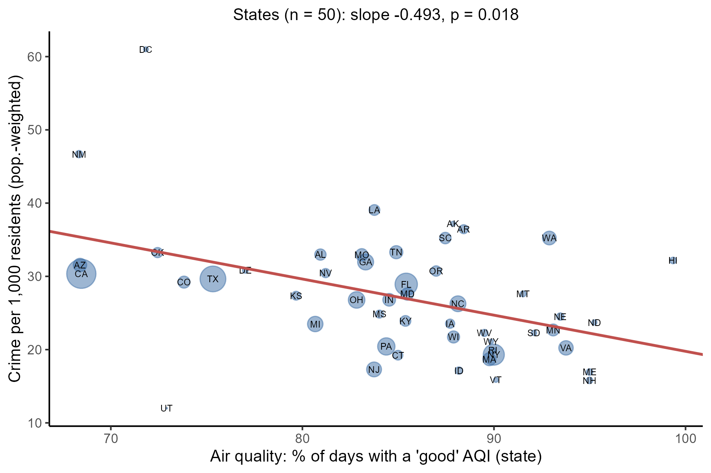

# Air Quality, Cost of Living, and Crime Across U.S. Counties

조지메이슨대학교 Computational and Data Sciences 학사 졸업논문입니다. (지도교수: Dr. Kent Miller)

2025년 12월에 제출한 버전을 2026년 10월에 다시 분석한 개정판입니다.
처음 분석에서 나온 "매우 유의한" 결과들이 통계적 착시였다는 것을 확인하고, 분석 단위와 방법을 고쳐 결론을 새로 냈습니다.

- 논문 전문 (42쪽): [docs/thesis_revised.pdf](docs/thesis_revised.pdf)
- 영문 2쪽 요약: [docs/summary_revised.pdf](docs/summary_revised.pdf)
- 한글 요약: [docs/SUMMARY_KO.md](docs/SUMMARY_KO.md)

## 연구 질문

사람들은 살 곳을 고를 때 범죄율, 생활비, 환경을 비교합니다. 이 연구는 세 가지를 물었습니다.

1. 대기질이 좋은 지역은 범죄율이 낮은가?
2. 생활비가 비싼 지역은 범죄율이 다른가?
3. 여러 요인을 함께 고려하면 어떤 요인이 범죄율과 가장 강하게 관련되는가?

## 결과

처음 분석에서는 대기질과 생활비 모두 p < 10^(-16)으로 나왔습니다. 다시 확인해 보니 세 가지 착시였습니다.

| 착시 | 무엇이 문제였나 | 바로잡은 뒤 |
|---|---|---|
| 부풀려진 표본 | 주 단위 대기질 값 50개가 학교 8.7만 행에 복사돼 있었음 | 주 단위 클러스터링, 표준오차 15배 증가 (t: −67 → −4.5) |
| 상쇄되는 교란 | 비싼 지역은 소득이 높으면서(범죄율 낮음) 도시적이기도 함(범죄율 높음) | 생활비와 범죄율은 관계 없음 (p = 0.62) |
| 지역을 대신한 변수 | 대기질이 나쁜 주는 대부분 서부·남서부 | 같은 권역 안에서 비교하자 효과 사라짐 (p = 0.03 → 0.36) |

범죄율과 가장 강하게 관련된 것은 소득(높을수록 범죄율이 낮음)과 도시화(클수록 범죄율이 높음)였습니다.
한 시점의 지역 간 비교라서 인과관계가 아니라 상관관계입니다.



## 재현 방법

1. Kaggle에서 데이터를 받아 `data/`에 넣습니다. ([data/README.md](data/README.md) 참고)
2. 이 폴더에서 R 스크립트를 실행합니다. 표는 `output/`, 그림은 `paper/`에 다시 만들어집니다.

   ```
   Rscript analysis.R
   ```

3. `paper/`에서 `pdflatex capstone.tex`를 두 번 실행하면 논문 PDF가 만들어집니다.

R 4.3.2에서 실행했고, `dplyr`, `readr`, `fixest`, `ggplot2`, `jsonlite` 패키지를 씁니다.

## 폴더 구성

```
analysis.R      전체 분석 (데이터 정리, 회귀분석, 표, 그림)
output/         LaTeX 표, 본문에 인용한 수치(facts.json)
paper/          논문·요약 LaTeX 원고와 그림
docs/           PDF와 한글 요약
data/           원자료 안내 (데이터 파일은 포함하지 않음)
```

---

## English summary

This is my undergraduate thesis in Computational and Data Sciences at George Mason University, written for the CDS 492 senior capstone course and revised in October 2026.

The first version reported that both air quality and cost of living were strongly associated with county crime (p < 10^-16). Re-examining the data showed that both results were spurious, for three different reasons:

- **Pseudo-replication.** Air quality is recorded once per state, so 87,457 school rows carried only 50 distinct values. Clustering by state raised the standard error 15 times.
- **Offsetting confounders.** Expensive counties are richer (less crime) and more urban (more crime). The two cancel, and cost of living shows no association (p = 0.62).
- **A geographic proxy.** States with the fewest good-air days are mostly in the West. Within Census regions the air-quality effect disappears (p = 0.36).

Across 2,892 counties, income (negative) and urbanization (positive) are the strongest correlates of crime. The data are cross-sectional, so these are associations, not causal effects.

Full paper: [docs/thesis_revised.pdf](docs/thesis_revised.pdf) · Two-page summary: [docs/summary_revised.pdf](docs/summary_revised.pdf)
